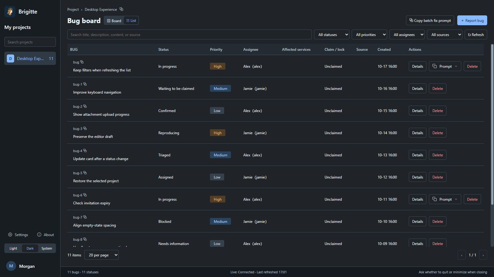

<p align="center"></p>

<h1 align="center">Asgard Brigitte</h1>

<p align="center">A native bug collaboration client built with .NET MAUI and Blazor Hybrid.</p>

<p align="center">
  <a href="https://github.com/BenLampson/Asgard.Brigitte.Desktop/actions/workflows/ci.yml"></a>
  <a href="LICENSE"></a>
  
</p>

<p align="center">English · <a href="README.zh-CN.md">简体中文</a></p>

Brigitte connects issue discovery, assignment, fixes, and verification in a project workspace. The current source defaults to local use: every launch offers **Use on this computer** first, without an account or network. Projects, bugs, replies, history, and attachment bodies stay in a separate local SQLite database. Online collaboration retains the existing sign-in and authenticated WebSocket synchronization.

This repository publishes the desktop client, shared synchronization contracts, bundled application resources, and tests under Apache-2.0. The Brigitte backend, web administration application, and production deployment are maintained separately in a private repository. Only online mode requires compatible Brigitte and Heimdall services. Local mode runs inside the desktop process, opens no service port, and does not upload or merge records with online workspaces. LAN sharing is not supported.

## Features

- Project boards, search and filters, bug editing, status transitions, comments, and activity history.
- Personal projects, member management, and invitation links with optional passwords and expiration, subject to server authorization.
- Markdown editing, attachments, drag and drop, image paste, previews, and downloads.
- Browser-based OIDC/PKCE login, platform secure credential storage, session restoration, and refresh.
- Incremental synchronization, local SQLite reads, unread activity, desktop notifications, and a system tray.
- Separate task windows, light/dark/system themes, and persistent device preferences.
- English and Simplified Chinese, with instant language switching and system-language selection by default.
- Copyable AI repair prompts and MCP Key management for external tools. No AI model is bundled.

## Platform status

Windows is the primary development platform and is built in CI using MAUI, WinUI 3, and WebView2. macOS sources use Mac Catalyst and an AppKit tray bridge; building and validating them requires a Mac with Xcode. There is no Linux desktop host, but the Core/UI tests can run without MAUI. Version `1.0.0` failed Store certification because online discovery blocked access to the workspace. Version `1.0.1` is available in Microsoft Store. Version `1.0.2` adds complete board status visibility and verified claimant display. macOS signing and notarization remain separate release work.

## Help, privacy, and language

Download the Windows x64 portable build from [GitHub Releases](https://github.com/BenLampson/Asgard.Brigitte.Desktop/releases/latest). Extract the full ZIP and run `Asgard.Brigitte.Desktop.exe`; WebView2 Runtime is required. Local use needs no account or server. See the [1.0.10 release notes](docs/releases/v1.0.10.md) and [Store submission log](packaging/windows/store-submission.md) for current changes and distribution status.

Use [GitHub Issues](https://github.com/BenLampson/Asgard.Brigitte.Desktop/issues/new/choose) for bugs and feature requests; English and Chinese are welcome. See the [support guide](SUPPORT.md), [privacy policy](PRIVACY.md) ([简体中文](PRIVACY.zh-CN.md)), and [usage guide](docs/usage.en.md). Issues are public: remove private content and credentials. Privacy and account-deletion requests go to the email in the policy.

Open **Settings → General → Language** to choose **Follow system**, **简体中文**, or **English**. Chinese system languages use Simplified Chinese; other languages use English. The preference is saved on the device and applies to open windows. User content and server-provided templates remain in their original language.

Microsoft Store descriptions, public package identity, links, and submission status are in the [Store submission guide](packaging/windows/store-submission.md). The first submission failed certification on October 17, 2026; the local-first replacement is not yet certified or published. Free pricing and automatic publication after approval remain selected.



## Build on Windows

Install .NET SDK `10.0.401` or a compatible patch in the same feature band, the Windows SDK, and WebView2 Runtime, then run:

```powershell
git clone https://github.com/BenLampson/Asgard.Brigitte.Desktop.git
cd Asgard.Brigitte.Desktop
dotnet workload install maui-windows
dotnet build src/Asgard.Brigitte.Desktop/Asgard.Brigitte.Desktop.csproj -c Release
dotnet run --project src/Asgard.Brigitte.Desktop/Asgard.Brigitte.Desktop.csproj -f net10.0-windows10.0.19041.0
```

Open `Asgard.Brigitte.Desktop.slnx` to work on all desktop projects. The repository is self-contained and restores dependencies from public NuGet feeds; no private backend checkout is needed.

The embedded configuration points to the existing Brigitte service and contains public native-client identifiers, with no client secret. Accounts and data access follow that service's policies. To target your own compatible service, update both `Resources/Raw/clientsettings.json` in the MAUI project and the defaults in `Desktop.Core/ClientOptions.cs`, then rebuild. Environment variables do not override this configuration.

## Development and documentation

```powershell
dotnet test --project tests/Asgard.Brigitte.Desktop.Tests/Asgard.Brigitte.Desktop.Tests.csproj -c Release
```

The tests use local transports and local OIDC fixtures. Core, Razor UI, and shared synchronization contracts are independent of the MAUI host. See the [usage guide](docs/usage.en.md), [Windows packaging guide](packaging/windows/README.md), and Chinese-language [development guide](docs/development.md), [synchronization protocol](src/Asgard.Brigitte.Desktop/SYNC.md), and [data handling notes](docs/data.md).

Contributions are welcome through [issues](https://github.com/BenLampson/Asgard.Brigitte.Desktop/issues) and pull requests. Read [CONTRIBUTING.md](CONTRIBUTING.md) and [SECURITY.md](SECURITY.md) first. Code and original assets are licensed under [Apache-2.0](LICENSE); see [NOTICE](NOTICE). Third-party dependencies retain their own licenses. The license does not grant trademark rights to the Brigitte or Asgard names or marks.
