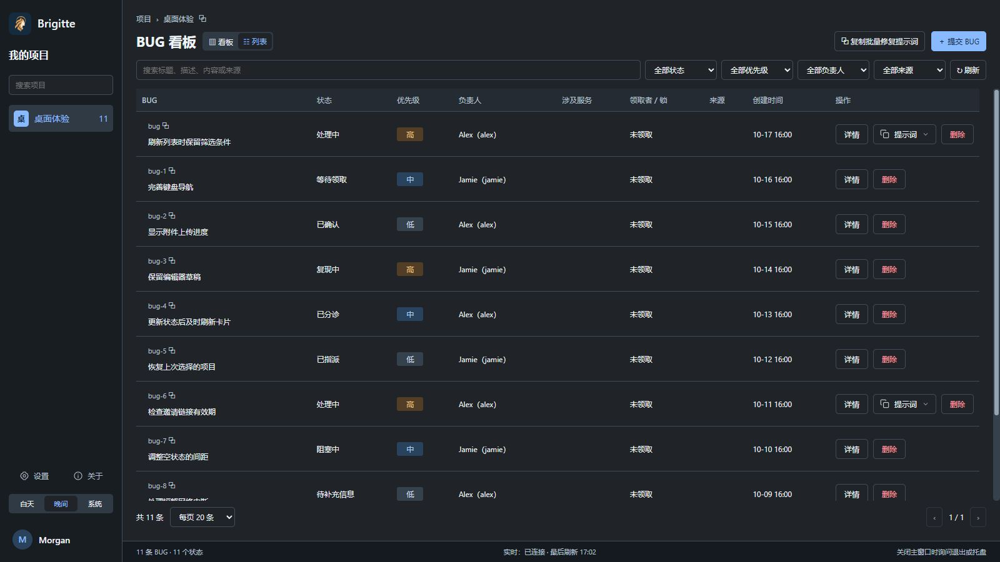

<p align="center">
  
</p>

<h1 align="center">Asgard Brigitte</h1>

<p align="center">让灵感向前，让问题止步。<br />基于 .NET MAUI 与 Blazor Hybrid 的 BUG 协作桌面客户端。</p>

<p align="center">
  <a href="https://github.com/BenLampson/Asgard.Brigitte.Desktop/actions/workflows/ci.yml"></a>
  <a href="LICENSE"></a>
  
</p>

<p align="center">简体中文 · <a href="README.md">English</a></p>

Brigitte 把问题发现、领取、处理和回归串在同一个项目工作区。当前源码默认提供本机模式：每次启动保留欢迎与登录入口，“本机使用”是默认主入口，无需注册、登录或联网。项目、BUG、回复、历史和附件正文保存在独立的本机 SQLite 中。在线模式继续使用现有登录流程和经过认证的 WebSocket 协作。

本仓库独立开源桌面客户端、共享同步协议、应用资源及测试。Brigitte 服务端、管理网站和部署配置由独立私有仓库维护，不包含在本仓库中。只有在线模式需要兼容的 Brigitte 服务和 Heimdall 身份服务。本机模式在桌面进程内运行，不开启服务端口，不自动上传或合并到在线工作区，不支持局域网共享。

## 功能

- 项目看板、搜索与筛选，BUG 创建、编辑、状态流转、回复和处理记录。
- 自建项目、成员管理，以及可设密码和有效期的邀请链接；实际权限由服务端决定。
- Markdown 编辑与预览，附件选择、拖放、图片粘贴、预览和下载。
- 系统浏览器 OIDC/PKCE 登录，系统安全存储保存凭据，自动恢复与续期。
- WebSocket 增量同步、SQLite 本地投影、未读动态、系统通知和托盘入口。
- 独立业务窗口，白天、晚间和跟随系统主题，关闭行为与界面偏好设置。
- 简体中文和 English 即时切换，默认跟随操作系统，语言偏好保存在设备上。
- 复制单条或项目级修复提示词，管理用于外部 AI 工具的 MCP Key。客户端本身不内置 AI 模型。

## 平台与状态

| 平台 | 实现 | 验证范围 |
| --- | --- | --- |
| Windows | .NET MAUI / WinUI 3 / WebView2 | 主要开发平台；CI 构建 Windows 应用 |
| macOS | .NET MAUI / Mac Catalyst / AppKit 托盘桥接 | 源码已提供；需在配有 Xcode 的 Mac 上构建及验收 |
| Linux | 不提供桌面宿主 | 可运行平台无关的 Core/UI 单元测试 |

`1.0.0` 于 2026 年 10 月 17 日认证失败，原因是在线 discovery 失败阻断了工作区体验。`1.0.1` 已在微软商店上架，支持完整本机使用；`1.0.2` 补齐看板状态并显示可信领取用户。仍选择免费及通过认证后自动发布。macOS 的签名、公证和系统集成需由发布者在 Mac 上验证。

## 帮助、隐私与语言

Windows x64 便携版从 [GitHub Releases](https://github.com/BenLampson/Asgard.Brigitte.Desktop/releases/latest) 下载。完整解压 ZIP 后运行 `Asgard.Brigitte.Desktop.exe`，需要 WebView2 Runtime。本机使用无需账号或服务器。本次变更和分发状态见 [1.0.10 更新说明](docs/releases/v1.0.10.md)及[商店提交记录](packaging/windows/store-submission.md)。

普通问题和功能建议统一[提交 GitHub Issue](https://github.com/BenLampson/Asgard.Brigitte.Desktop/issues/new/choose)，支持中英文。Issue 是公开的，请先移除私有内容和凭据。详见[支持说明](SUPPORT.zh-CN.md)、[隐私政策](PRIVACY.zh-CN.md)（[English](PRIVACY.md)）及[使用说明](docs/usage.md)。隐私和账号删除请求请使用政策中的邮箱。

在**设置 → 普通设置 → 语言**选择**跟随系统 / 简体中文 / English**。中文系统语言使用简体中文，其他语言使用英文；切换即时作用于已打开窗口，偏好保存在当前设备。用户内容和服务端模板保持原文。

商店中英文介绍、正式公开包标识、各项链接及提交状态见[Microsoft Store 提交指南](packaging/windows/store-submission.md)。本机优先的新包、双语商品页及审核步骤正在准备；不能将本地验收或包验证当作认证已通过。



## 从源码运行

Windows 需要 .NET SDK `10.0.401` 或同功能带兼容补丁、`maui-windows` workload、Windows SDK，以及 WebView2 Runtime。

```powershell
git clone https://github.com/BenLampson/Asgard.Brigitte.Desktop.git
cd Asgard.Brigitte.Desktop
dotnet workload install maui-windows
dotnet build src/Asgard.Brigitte.Desktop/Asgard.Brigitte.Desktop.csproj -c Release
dotnet run --project src/Asgard.Brigitte.Desktop/Asgard.Brigitte.Desktop.csproj -f net10.0-windows10.0.19041.0
```

也可以直接打开 `Asgard.Brigitte.Desktop.slnx`。macOS 构建、便携版发布和服务连接配置见[开发说明](docs/development.md)，MSIX 见[Windows 打包](packaging/windows/README.md)。

默认配置连接现有 Brigitte 服务，包含原生 public client 的公开标识，不包含客户端 Secret。登录、注册和项目访问取决于该服务的实际策略；开源许可证不授予任何线上数据或管理员权限。连接自己的兼容服务时，需要修改内嵌的 `clientsettings.json` 和 `ClientOptions.cs` 默认值，再重新构建，详见开发说明。

## 结构

```text
src/
  Asgard.Brigitte.Desktop/       MAUI 原生宿主、平台窗口、托盘与安全存储
  Asgard.Brigitte.Desktop.UI/    共享 Razor 界面与样式
  Asgard.Brigitte.Desktop.Core/  会话、HTTP、同步与本地 SQLite
  Asgard.Brigitte.Sync/          客户端与服务端共享的同步契约
tests/                         平台无关测试与 Windows 手动检查辅助脚本
packaging/windows/             MSIX 清单模板与打包脚本
```

所有项目引用均在本仓库内，依赖从公开 NuGet 源还原，无需克隆私有服务端仓库。

## 文档与参与

- [使用说明](docs/usage.md)：登录、项目与邀请、断线行为和 AI 协作。
- [开发说明](docs/development.md)：环境、配置、构建与测试。
- [同步协议](src/Asgard.Brigitte.Desktop/SYNC.md)：清单、批次、SQLite 提交与命令确认。
- [隐私与本地数据](docs/data.md)：凭据、缓存、通知与附件。
- [贡献指南](CONTRIBUTING.md) · [安全问题报告](SECURITY.md) · [提交问题](https://github.com/BenLampson/Asgard.Brigitte.Desktop/issues)

## 许可证

本仓库代码和原创资源采用 [Apache License 2.0](LICENSE)，版权声明见 [NOTICE](NOTICE)。第三方依赖保留各自许可证。许可证不授予 Brigitte 或 Asgard 名称、标识的商标权。
